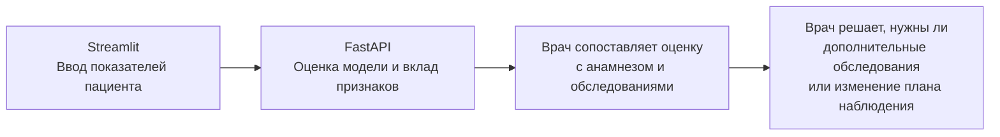
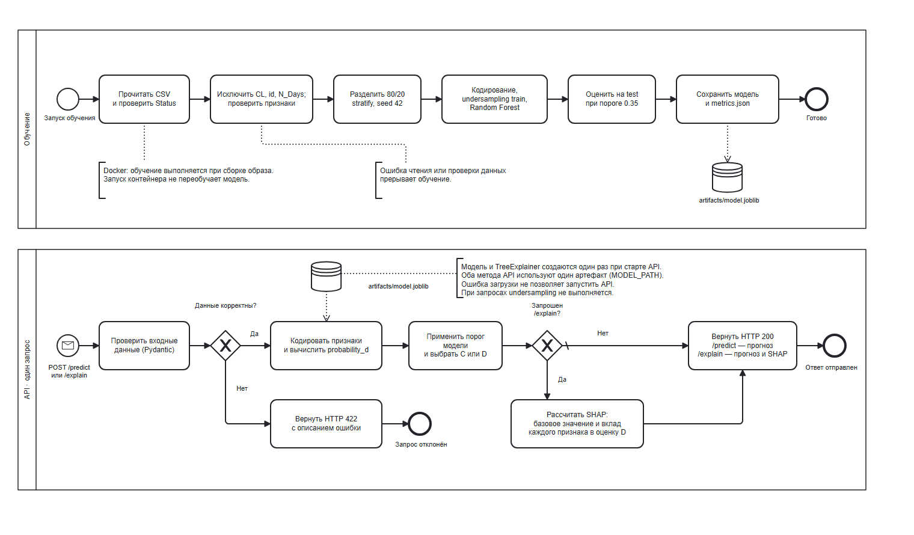

# Модель в процессе поддержки врачебной оценки

Прикладная цель — помочь врачу оценить неблагоприятный прогноз пациента
с циррозом печени и определить необходимость более подробной оценки состояния
или пересмотра плана наблюдения.

## Роль модели

Random Forest анализирует показатели пациента и выдаёт предварительную оценку
исхода: `D` — смерть или `C` — цензурированное наблюдение, а также численную оценку
`probability_d`. В предполагаемом врачебном процессе этот результат служит
дополнительным основанием для внимательной оценки состояния пациента.

Схема ниже показывает предполагаемый врачебный процесс после клинической
валидации. Реализованный API выполняет проверку входных данных и расчёт оценки;
решение о дальнейших действиях принимает врач.

## Технический процесс

Схема показывает обучение модели, прогноз через `POST /predict` и прогноз
с объяснением SHAP через `POST /explain`. Их связывает артефакт `artifacts/model.joblib`.

Модель загружается один раз при запуске API; тогда же создаётся объект для расчёта
SHAP. Для локального запуска её предварительно
обучают командой из [README](README.md#данные-и-обучение);
в Docker обучение выполняется при сборке образа.

Перед обучением можно отдельно подобрать гиперпараметры с Optuna, используя
кросс-валидацию на обучающей части данных. Путь к JSON-файлу с выбранными
параметрами передаётся команде обучения через аргумент `--params`.
Сам подбор сохраняет параметры, а не модель; при обычном обучении и сборке
Docker он не запускается.

К оценке `probability_d` применяется сохранённый порог 0.35:
значение не ниже порога даёт `D`, иначе — `C`.
API возвращает HTTP 200 и JSON с полями `predicted_class`, `predicted_status`,
`probability_d` и `threshold`. Ответ доступен через `/docs`, HTTP-клиент
или подключённое к API приложение.

Ответ `/explain` содержит базовое значение модели и вклад каждого признака
в оценку D по версии SHAP.

[Редактируемый BPMN](docs/process.bpmn) · [Векторная версия](docs/process.svg).

## Почему используется ML

Исход может быть связан с сочетанием нескольких показателей, поэтому анализ
отдельного значения не описывает всю картину. ML позволяет изучать такие сочетания
по примерам с известными исходами. Random Forest работает с табличными данными
и учитывает нелинейные зависимости между признаками и исходом.

Практическая ценность — автоматически получать единую оценку по совокупности
показателей и предоставлять её пользователю через API. Качество такого подхода измеряется
на отложенных данных: recall отражает полноту обнаружения `D`, precision —
долю верных предсказаний среди ответов `D`.

## Входные данные

Клиент отправляет в `POST /predict` или `POST /explain` JSON с 17 признаками: возрастом, полом,
препаратом, клиническими признаками, лабораторными показателями и стадией заболевания.
Поля и единицы соответствуют [карточке модели](model_card.md);
[пример запроса](examples/predict_request.json) содержит полный набор полей.
`Status`, `id` и `N_Days` в запрос не входят.

Streamlit предоставляет форму ввода и отправляет запрос в `POST /explain`.
Возраст вводится целым числом лет и переводится в дни перед отправкой; остальные значения
сохраняются в исходной шкале. Формат данных проверяется тем же API.
В форме действуют [ограничения ввода](docs/input_limits.md) для защиты от ошибок масштаба.

Неверные данные отклоняются с HTTP 422; корректные проходят кодирование признаков
и передаются модели. Балансировка классов применяется только при обучении.

## Использование результата

Предполагаемый сценарий после клинической валидации:

1. Врач получает предсказанный класс и численную оценку модели.
2. Сопоставляет их с анамнезом, осмотром и результатами обследований пациента.
3. Определяет, требуется ли дополнительная оценка состояния или пересмотр
   плана наблюдения. Выбор лечения остаётся отдельным клиническим решением.

Для пациента возможная польза — получить нужное дополнительное обследование
или контрольный приём.

Текущая реализация — прототип: клиническая валидация и оценка влияния на качество
лечения не проводились. Значение `probability_d` не является подтверждённым
индивидуальным риском; `C` не означает выздоровление. Подробные условия применения
приведены в [карточке модели](model_card.md).
