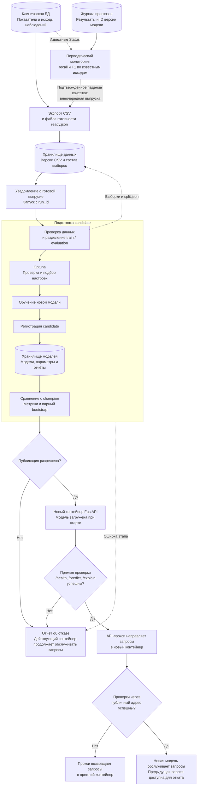

# Автоматическое переобучение и публикация модели

Документ описывает **целевой автоматический процесс переобучения ML-модели на новых данных**. Обучение Random Forest,
подбор параметров с Optuna и API FastAPI уже реализованы. Клиническая БД,
экспорт данных, объектное хранилище, журнал прогнозов, мониторинг качества,
автоматическая публикация и API-прокси
описаны как компоненты предполагаемого внедрения.

**Candidate** — новая модель, проходящая проверки. **Champion** — модель,
которую использует сервис. Исходная champion — текущая модель проекта.

## Схема процесса

## Откуда поступают данные

В предполагаемой медицинской системе врач и медицинский персонал ведут записи
об осмотрах, анализах и исходах наблюдений; они сохраняются в клинической БД.
Когда появляются новые записи с известным исходом `Status`,
задание выгрузки читает их из БД и создаёт CSV в формате проекта.
БД остаётся источником медицинских записей; CSV — снимок данных для обучения.

CSV загружается в **объектное хранилище** — например, S3-совместимое хранилище
с именем бакета `cirrhosis-ml`. После завершения загрузки создаётся
`ready.json` с версией данных, адресом CSV и его SHA-256. Уведомление о создании
этого файла запускает процесс переобучения.

Пример адреса CSV: `s3://cirrhosis-ml/datasets/data-001/raw.csv`.
Это адрес файла внутри хранилища: `cirrhosis-ml` — имя бакета,
`datasets/data-001/raw.csv` — путь к конкретной выгрузке. Задание переобучения
читает этот адрес из `ready.json` и скачивает файл.

## Дополнительный триггер: снижение качества

В целевой системе **журнал прогнозов** хранит результаты запросов к действующему
API. Каждая запись содержит идентификатор наблюдения, время расчёта, идентификатор
использованной версии модели, предсказанный класс, оценку D и порог.

Проверка качества выполняется по расписанию. Допустимые нижние границы метрик и минимальное
число наблюдений C и D в окне задаются в настройках мониторинга по результатам
оценки на целевых данных. Сигнал подтверждается, если одна из метрик ниже своей
границы в двух последовательных непересекающихся окнах, удовлетворяющих этим
требованиям. Без известных исходов метрики качества не рассчитываются;
изменение распределения признаков само по себе не считается доказанной деградацией.

Подтверждённый сигнал запрашивает внеочередную выгрузку. После её готовности
запускается тот же процесс с причиной `quality_degradation`; для обычного
поступления данных используется `new_data`. Причина сохраняется в отчёте запуска.

## Этапы и передаваемые результаты

| Этап | Что происходит | Результат для следующего шага |
| --- | --- | --- |
| 1. Триггер | Готова очередная выгрузка новых размеченных данных либо внеочередная выгрузка по подтверждённому сигналу мониторинга. Создание `ready.json` запускает процесс; фиксируются `run_id`, причина запуска и версия champion. | Идентификатор и причина запуска (`new_data` или `quality_degradation`), версия данных, адрес `raw.csv` и хеш файла. |
| 2. Подготовка данных | CSV скачивается, проверяются хеш, обязательные поля, значения признаков и метки `Status`. Строки `CL` исключаются; `id` и `N_Days` не используются как признаки. Формируются train и evaluation без пересечения записей. | Сохранённые `train.csv`, `evaluation.csv` и `split.json`, определяющий состав обеих выборок. |
| 3. Подбор параметров | Optuna начинает поиск с гиперпараметров действующей модели, затем проверяет другие комбинации в заданных диапазонах. Все варианты оцениваются на одной схеме кросс-валидации: 30 попыток, 5 фолдов, seed 42, recall класса `D` при пороге 0.35. | Выбранные гиперпараметры, оценки вариантов и настройки поиска. |
| 4. Обучение candidate | Pipeline с выбранными гиперпараметрами обучается на всей train. Применяются кодирование признаков и `RandomUnderSampler`. | Обученная модель и порог 0.35. |
| 5. Регистрация candidate | В хранилище моделей создаётся новая версия со статусом `candidate`; сохраняются модель, параметры и сведения о данных, коде и зависимостях. | Адрес артефакта `models/<model_version>/model.joblib` и метаданные версии. |
| 6. Проверка качества | Candidate и champion загружаются из хранилища и оцениваются на одной evaluation. Рассчитываются precision, recall, F1, матрицы ошибок и интервалы разностей метрик. Проверяются загрузка модели и совместимость с API. | Сохранённый отчёт сравнения и результаты технических проверок. |
| 7. Решение о публикации | Применяется правило публикации. Решение и его основания сохраняются в отчёте. При отказе запросы продолжает обслуживать champion. | Разрешение на тестовый запуск либо отчёт об отказе. |
| 8. Проверка деплоя | Запускается второй контейнер FastAPI с candidate. Публичные запросы в него пока не направляются; процесс деплоя проверяет его `/health`, `/predict` и `/explain` напрямую. | Готовый контейнер с проверенной моделью и его внутренний адрес. |
| 9. Активация | API-прокси переводит новые запросы на проверенный контейнер. Выполняется проверка через обычный адрес сервиса; после успеха версия становится champion. | Активная версия, отчёт о деплое и сохранённая конфигурация для отката. |

## Что сохраняется в хранилищах

Хранилища данных и моделей на схеме — два логических раздела одного объектного
хранилища. Ни снимки данных, ни модель не перезаписываются под прежней версией.

- `datasets/<data_version>/`: `raw.csv`, `ready.json`, `train.csv`,
  `evaluation.csv` и `split.json`.
- `models/<model_version>/`: `model.joblib`, гиперпараметры, настройки и результаты
  Optuna, отчёт сравнения и метаданные происхождения модели.
- `runs/<run_id>/`: решения о публикации, результаты проверок и ошибки.
- `predictions/<model_version>/`: журнал прогнозов для сопоставления с известными исходами.

**Проверенная выборка** означает, что её строки прошли проверки схемы:
обязательные поля заполнены, категории и `Status` допустимы, числовые значения
соответствуют правилам [PatientData](src/cirrhosis_service/preprocessing.py),
а в обучающей части достаточно наблюдений обоих классов для 5 фолдов.

**Состав выборок** хранится в `split.json`: например,
`{"train_ids": [101, 102], "evaluation_ids": [201, 202]}`.
Здесь `id` — стабильный технический идентификатор наблюдения из выгрузки. Он нужен, чтобы воспроизвести разбиение и проверить,
что одна запись не попала в обе выборки. `id` сохраняется в учёте данных,
но исключается из признаков перед обучением.

Evaluation формируется из наблюдений, не входивших в обучение ни candidate,
ни champion. Её записи не используются в Optuna. Старую train можно объединять
с новой обучающей частью. В каждом фолде Optuna модель, предобработка и
undersampling обучаются заново только на обучающей части фолда.

Метаданные модели связывают её с версией данных, `split.json`, гиперпараметрами,
идентификатором кода, зависимостями, seed и порогом. Сведения о текущей champion
и статусах версий обновляются отдельно от неизменяемых файлов моделей.

## Сравнение и правило публикации

Обе модели предсказывают исходы на **одних и тех же контрольных записях**
при пороге 0.35. Затем их метрики сравниваются.

Используется **парный bootstrap: 2 000 повторов, seed 42**. В каждом повторе
строки контрольной выборки выбираются с возвращением. Одни и те же индексы
применяются к истинным меткам и предсказаниям обеих моделей. Рассчитываются:

- `ΔRecall = Recall(candidate) − Recall(champion)`;
- `ΔF1 = F1(candidate) − F1(champion)`.

Для каждой разности строится 95% доверительный интервал перцентильным методом:
от 2.5-го до 97.5-го процентиля полученного распределения. Повторное обучение внутри bootstrap
не выполняется.

**Публикация разрешена, если одновременно:**

- нижняя граница интервала `ΔF1` **больше 0**;
- нижняя граница интервала `ΔRecall` **не меньше 0**;
- проверки данных, загрузки модели и совместимости с API пройдены.

Это консервативное правило: нужна подтверждённая сравнением прибавка F1
при выполнении требования к recall. Если данных недостаточно, сравнение
невозможно или интервалы не позволяют принять решение, candidate не публикуется.
Отчёт сохраняет метрики, интервалы и причину решения.

## Почему запускается новый контейнер

Тестовый контейнер — **второй экземпляр того же FastAPI-приложения** с новой
моделью. Он может работать на том же сервере, что и действующий контейнер,
но имеет собственное имя и внутренний адрес. API-прокси — например, Nginx —
сохраняет один публичный адрес сервиса и сначала направляет запросы только
в действующий контейнер. Проверки candidate выполняются по адресу второго
контейнера; пользователи продолжают получать ответы от champion.

Перед запуском артефакт скачивается из хранилища моделей и монтируется в новый
контейнер только для чтения. Например, `MODEL_PATH=/models/model-002/model.joblib`
указывает на локальный файл внутри контейнера.
Контейнер использует совместимую версию кода и зависимостей.

В существующем API модель загружается в `app.state.model` один раз при старте.
Изменение `MODEL_PATH` или файла на диске не заменяет объект в памяти.
При таком способе загрузки новая версия загружается только при запуске процесса.
В выбранной схеме сначала запускается и проверяется второй контейнер, затем прокси направляет новые запросы
в него. Останавливать действующий контейнер для загрузки candidate не требуется;
ранее начатые запросы могут завершиться в прежнем контейнере.

Загрузка модели на ходу также возможна, но потребует отдельного механизма:
загрузить и проверить новый объект, согласованно заменить его во всех процессах
и сохранить старую модель для уже выполняющихся запросов и отката.
Выбранная замена контейнера проще проверяется: запущенная версия модели,
код и зависимости фиксированы, а откат выполняется сменой адреса в прокси.
На время проверки нужны ресурсы для двух контейнеров.

## Неуспешные проверки и откат

Ошибка данных, подбора гиперпараметров, обучения, сохранения или сравнения останавливает процесс
до переключения запросов. Отказ по качеству или ошибка тестового контейнера
также сохраняет действующую champion. Причина записывается в отчёт запуска.

Перед переключением сохраняются версия модели, образ и адрес прежнего контейнера,
его `MODEL_PATH` и конфигурация прокси. Если после переключения проверки через
публичный адрес сервиса не проходят, прокси возвращает запросы в прежний контейнер;
его `/health`, `/predict` и `/explain` проверяются повторно. Candidate не получает статус
champion, сохраняется отчёт об откате. Прежний контейнер не удаляется до успешного
завершения проверки новой версии. Если восстановление не удалось, ошибка
передаётся ответственному за сервис.

Связанные документы: [запуск и обучение](README.md),
[карточка модели](model_card.md), [модель в процессе проекта](Model_BPMN.md).
Технические основания: [загрузка при старте FastAPI](https://fastapi.tiangolo.com/advanced/events/),
[уведомления объектного хранилища](https://docs.aws.amazon.com/AmazonS3/latest/userguide/EventNotifications.html),
[управление конфигурацией Nginx](https://nginx.org/en/docs/control.html).
